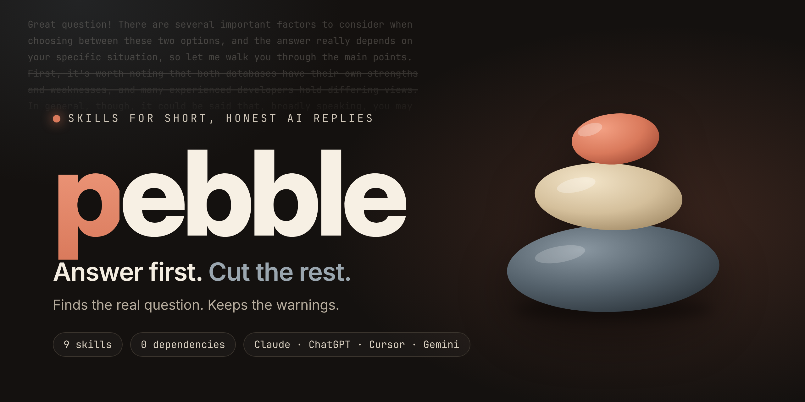
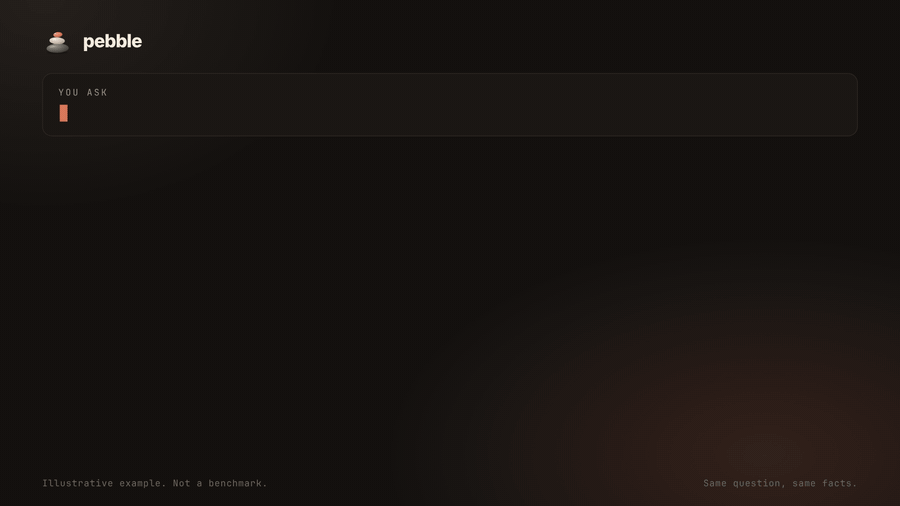

<p align="center">
  
</p>

<p align="center">
  <a href="LICENSE"></a>
  
  
  
  <a href="https://github.com/amItuff/pebble/actions/workflows/ci.yml"></a>
</p>

<p align="center">
  <b>English</b> · <a href="README.vi.md">Tiếng Việt</a>
</p>

<h3 align="center">AI replies that find the real question, answer it in the first sentence, and keep the warnings.</h3>

<p align="center">
  <a href="assets/demo.mp4">
    
  </a>
  <br>
  <sub>26-second demo (<a href="assets/demo.mp4">MP4</a>). The two answers are hand-written to show the idea. They are <b>not</b> a benchmark.</sub>
</p>

---

## The problem

Ask a simple question, get a lecture: praise for the question, a restatement of it, five caveats, a list of options, and an offer to "go into more detail". You read all of it to find one sentence.

Long chats make it worse. Every new message re-sends the whole history, so wasted words are paid for again and again.

## What pebble does

Pebble is a small set of [Agent Skills](https://code.claude.com/docs/en/skills)-style instructions. The core one changes how the model answers:

1. **Finds the real question** behind the one you typed.
2. **Answers in the first sentence.** No "Great question", no restating, no closing offers.
3. **Picks one option** when one is clearly best, instead of listing five.
4. **Never shortens what must stay exact:** code, commands, numbers, error text.
5. **Keeps one `⚠` line** whenever there is real risk: data loss, security, money, health, legal, irreversible steps.
6. **Widens on purpose** when a short answer would be wrong or skip a required step.

> Plain English, normal grammar. Pebble is not a "talk like a caveman" trick. The model still writes full sentences; it just stops writing the ones you did not need.

### Before / after

| | Without pebble | With pebble |
|---|---|---|
| **You ask** | *Should I use MongoDB or Postgres for my small booking app?* | *(same)* |
| **Reply** | *Great question! Choosing between MongoDB and PostgreSQL really depends on a number of factors, so let me walk you through the main considerations. MongoDB is a popular document database... PostgreSQL, on the other hand... For a booking app, you will likely have entities such as... That said, both options can work... I hope this helps! Let me know if you'd like...* (167 words) | **Postgres.** Bookings are relational and need transactions to prevent double-booking.<br>**⚠** If two users can book the same slot, enforce it with a unique constraint, not app code. (28 words) |

*Illustrative example written by hand. Real replies vary. See [Benchmark](#benchmark) for how to measure your own setup.*

More in [`examples/`](examples/README.md).

## Modes

| Mode | Prose limit | Switch with |
|---|---|---|
| `brief` | One sentence | `/pebble brief` or "be brief" |
| `plain` (default) | At most 3 sentences | `/pebble plain` |
| `full` | Normal length, no filler | `/pebble full` |
| off | Normal behaviour | `/pebble off` or "pebble off" |

Say "explain", "why" or "step by step" and you get one full-length reply, then pebble goes back to your mode.

## The 9 commands

Only the core `pebble` skill loads by itself. The other eight are **manual commands** (`disable-model-invocation: true`): per the Claude Code docs their descriptions stay out of context and the full skill loads only when you call it.

| Command | What it does |
|---|---|
| `pebble` | **Core.** Real question first, answer in sentence one, filler cut, `⚠` line kept. |
| `/pebble-intent` | One line `Q: <real question> · Assuming: ...`, then the answer. Asks one question only when a wrong guess is costly. |
| `/pebble-verify` | Tags the claims the answer depends on as `[sure]` `[guess]` `[unchecked]` and lists what *you* should check. Never invents a source, URL or number. |
| `/pebble-audit` | Finds where this chat wasted tokens (pasted files, repeats, long replies, detours). Ranked, with a concrete cut for each. All figures are labelled estimates. |
| `/pebble-handoff` | Compresses the chat into a note under about 200 words to paste into a fresh chat. Code and paths stay verbatim. |
| `/pebble-rewrite` | Rewrites your vague prompt into a clear one *before* you send it. Adds nothing you did not say; marks gaps with `[?]`. |
| `/pebble-lint` | Scores a `SKILL.md`: trigger quality, size, overlap, contradictions. Backed by a real script, [`scripts/lint_skill.py`](scripts/lint_skill.py). |
| `/pebble-gain` | Prints measured benchmark results, or says plainly that there are none yet. It never estimates your savings. |
| `/pebble-help` | Modes and commands on one screen. |

## Install

### Claude Code (plugin)

```text
/plugin marketplace add amItuff/pebble
```

```text
/plugin install pebble@pebble
```

Plugin commands are namespaced, for example `/pebble:pebble-help`. Prefer short names? Copy the skills instead:

```bash
git clone https://github.com/amItuff/pebble && cp -r pebble/skills/* ~/.claude/skills/
```

That gives you `/pebble-help`, `/pebble-intent` and the rest.

### Make it always on

A skill is chosen by the model from its description, so "every reply" is a request, not a guarantee. To force it, append [`ports/generic/AGENTS.md`](ports/generic/AGENTS.md) to your `CLAUDE.md` (or `AGENTS.md`).

### Other tools

These are plain-text instruction files generated from the same source, so they never drift. Copy the one you need.

| Tool | File | Where it goes |
|---|---|---|
| **Claude.ai** (chat) | [`ports/claude-ai/project-instructions.md`](ports/claude-ai/project-instructions.md) | Project instructions, or your profile preferences |
| **ChatGPT** | [`ports/chatgpt/custom-instructions.md`](ports/chatgpt/custom-instructions.md) | Settings → Personalization → Custom instructions |
| **Cursor** | [`ports/cursor/pebble.mdc`](ports/cursor/pebble.mdc) | `.cursor/rules/pebble.mdc` |
| **Gemini CLI** | [`ports/gemini/GEMINI.md`](ports/gemini/GEMINI.md) | `GEMINI.md` in your project or `~/.gemini/` |
| **GitHub Copilot** | [`ports/copilot/copilot-instructions.md`](ports/copilot/copilot-instructions.md) | `.github/copilot-instructions.md` |
| **Anything else** | [`ports/generic/AGENTS.md`](ports/generic/AGENTS.md) | Wherever your tool reads rules |

The ChatGPT and Claude.ai versions are a compact rewrite under 1,500 characters. The slash commands need a skill-capable host such as Claude Code; the instruction files carry the core rules only.

## What pebble never cuts

Short is the goal. Wrong or unsafe is the failure. These are fixed:

- **Code, commands, numbers, names, error text:** never abbreviated or paraphrased.
- **The `⚠` line:** survives every mode, including `brief`. But no ritual disclaimers: if there is no real risk, there is no line.
- **Required steps:** a procedure keeps all its steps.
- **One question over a costly guess:** when a missing fact makes a wrong answer expensive, it asks exactly one question.
- **Your instructions:** if you ask for a long essay or a specific format, you get it.

## Benchmark

Measured on 2026-11-11 with `claude-sonnet-5-5`, through the `claude` CLI ([`bench/run_cli.py`](bench/run_cli.py)): 24 fixed prompts, 3 runs per arm. Raw replies and token counts are committed in [`bench/results/raw/`](bench/results/raw/).

| Arm | Median output tokens | Median words | Output-token cut | Risk warning kept (7 risk prompts) | `⚠` on non-risk prompts |
|---|---|---|---|---|---|
| no skill | 501.5 | 209.5 | n/a | 100% | 0% |
| `plain` | 101.5 | 41.5 | **74.9%** | **100%** | 13.7% |
| `brief` | 106.5 | 43.0 | 73.8% | 100% | 13.7% |

Cut = geometric mean over prompts of median output tokens against the no-skill arm. Pebble was never longer than the baseline on any prompt. Loading the skill adds about **870 input tokens** per call.

**Read these numbers with their limits:**

- **`brief` did not cut more than `plain`.** `plain` replies are already about 40 words. The `brief` mode is not yet earning its place; see the roadmap.
- **Not a quality measurement.** The automatic checks are keyword matches. I read the replies to all 7 risk prompts and found them correct with a sensible warning, but that was a read-through by the author's AI assistant, not a blind human review. `python bench/report.py --blind-sheet` writes a shuffled A/B sheet for you to judge.
- **The baseline is "You are a helpful assistant." with tools off.** Your real default (Claude Code, claude.ai) has its own system prompt, so your cut may be smaller.
- **Tuned on the same prompts.** The first run showed `⚠` on 49% of non-risk prompts, because an early rule also asked for a warning on "a very common mistake". I removed that clause and re-ran. Both runs are committed ([first report](bench/results/2026-11-11-run1-before-fix.md)), but the second was tuned against this prompt set, so treat it as optimistic.
- The remaining 13.7% are mostly defensible (rewriting pushed git history, double-booking, floating-point money), so the false-alarm check is crude rather than proof of a defect.
- One model, English only, 3 runs. The "asks when vague" check has only 2 prompts and is too noisy to quote.
- **Output tokens usually cost several times more per token than input tokens** (check current pricing), which is why a smaller reply can outweigh the extra input, but the net depends on your pricing and caching. This repo does not claim a dollar saving.

Also measured with `python scripts/lint_skill.py skills/`: the idle cost of all auto-loading descriptions is about 48 tokens (character count / 4). That estimate was too low for the skill body: it predicted ~600 tokens, and the real input overhead was ~870.

Reproduce it, without an API key, if you have the `claude` CLI:

```bash
python bench/run_cli.py --runs 3 && python bench/report.py
```

With an API key instead: `python bench/run.py`. Method and limits: [`bench/README.md`](bench/README.md). Please open a PR with your own run, especially if pebble loses.

## How it differs from other "short answer" skills

Some popular skills (for example [caveman](https://github.com/JuliusBrussee/caveman)) cut tokens by changing the model's *voice* into clipped, stylised prose. That can compress hard and is fun. Pebble makes a different trade:

- normal grammar and tone, so replies are easy to forward or paste;
- a hard floor for warnings, exact code and required steps;
- honesty tools for chat users (`/pebble-verify`, `/pebble-intent`), not only coding agents;
- chat-level token tools (`/pebble-audit`, `/pebble-handoff`), because history re-sent on every turn is often the bigger cost;
- every number in the README is either measured by a script in this repo or absent.

If you want maximum compression and like the voice, use those. If you want normal prose that still warns you, use pebble. They are not mutually exclusive.

## FAQ

**Will it hurt answer quality?**
It is designed not to: rule 6 widens the answer when brevity would make it wrong, and the risk line is fixed. But quality is a measurement, not a promise. Use the blind sheet to check your own prompts.

**Does it save money?**
It cut output tokens by about 75% in the benchmark above, and loading the core skill adds about 870 input tokens per call. Whether the net is positive depends on your pricing, caching and how wordy your replies were. This repo does not claim a dollar figure.

**Why are 8 of the 9 skills manual?**
Every auto-loading skill keeps its description in context in every chat. A token-saving tool should not spend tokens idling, so only the core one does.

**Does it work in my language?**
Rule 8 makes the model answer in your language. The benchmark prompts are English only so far; Vietnamese and other sets are welcome as PRs.

**It ignored pebble in a long chat.**
Models drift from instructions in long contexts. Make it always on (see [Install](#make-it-always-on)) or run `/pebble-handoff` and start fresh.

## Roadmap

- [x] First published benchmark run, including the false-alarm problem it exposed
- [ ] Make `brief` measurably shorter than `plain`, or drop it
- [ ] Blind human review of answer quality
- [ ] Re-run on other models and on a prompt set not used for tuning
- [ ] Vietnamese, Spanish and Chinese prompt sets for the benchmark
- [ ] Optional hook that re-injects the rule after context compaction
- [ ] `/pebble-review`: shorten a draft *you* wrote, keeping meaning

## Contributing

Bug reports, failing prompts and benchmark runs are the most valuable contributions. See [CONTRIBUTING.md](CONTRIBUTING.md). The whole project is plain Markdown plus three small Python scripts with no dependencies:

```bash
python -m unittest discover -s tests      # 21 tests
python scripts/lint_skill.py skills/      # lint every skill
python scripts/build_ports.py --check     # are the generated ports current?
```

## License

[MIT](LICENSE) © amItuff
