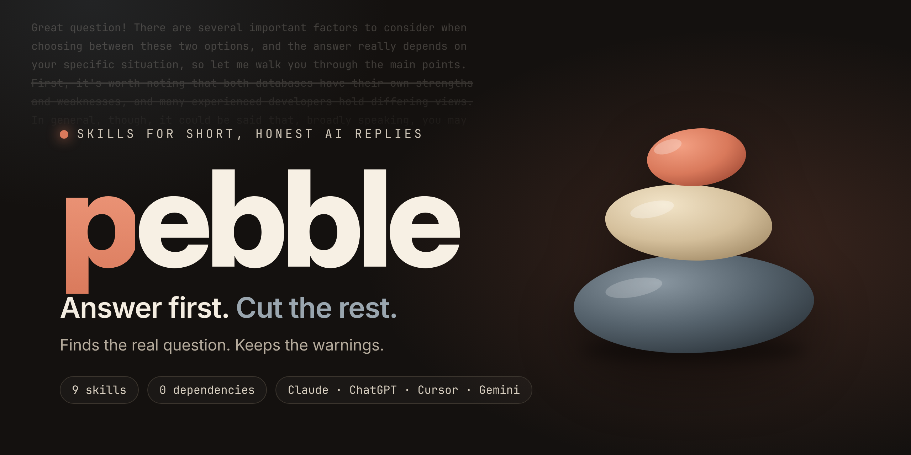
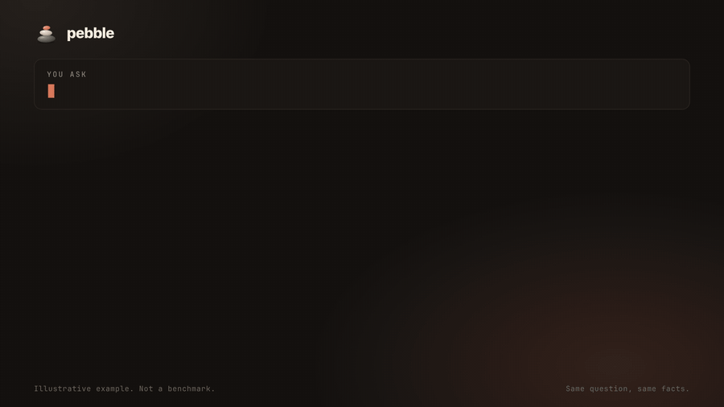

<p align="center">
  
</p>

<p align="center">
  <a href="LICENSE"></a>
  
  
  
  <a href="https://github.com/amItuff/pebble/actions/workflows/ci.yml"></a>
</p>

<p align="center">
  <a href="README.md">English</a> · <b>Tiếng Việt</b>
</p>

<h3 align="center">AI tìm ra câu hỏi thật, trả lời ngay câu đầu tiên, và vẫn giữ lại cảnh báo rủi ro.</h3>

<p align="center">
  <a href="assets/demo.mp4">
    
  </a>
  <br>
  <sub>Video 26 giây (<a href="assets/demo.mp4">MP4</a>). Hai câu trả lời được viết tay để minh họa ý tưởng, <b>không phải</b> kết quả benchmark.</sub>
</p>

---

## Vấn đề

Bạn hỏi một câu đơn giản, AI đáp lại cả một bài giảng: khen câu hỏi, nhắc lại câu hỏi, năm lời rào đón, danh sách các lựa chọn, rồi mời "cần giải thích thêm không". Bạn phải đọc hết để tìm đúng một câu.

Chat càng dài càng tệ: mỗi tin nhắn mới đều gửi lại toàn bộ lịch sử, nên lời thừa bị tính phí lặp đi lặp lại.

## Pebble làm gì

Pebble là một bộ chỉ dẫn nhỏ theo kiểu [Agent Skills](https://code.claude.com/docs/en/skills). Skill lõi thay đổi cách mô hình trả lời:

1. **Tìm câu hỏi thật** đằng sau câu bạn gõ.
2. **Trả lời ngay câu đầu tiên.** Không "Câu hỏi hay quá", không nhắc lại câu hỏi, không lời mời cuối bài.
3. **Chọn một phương án** khi có một cái rõ ràng tốt nhất, thay vì liệt kê năm cái.
4. **Không bao giờ rút gọn thứ phải giữ nguyên:** code, lệnh, con số, nội dung báo lỗi.
5. **Giữ một dòng `⚠`** mỗi khi có rủi ro thật: mất dữ liệu, bảo mật, tiền bạc, sức khỏe, pháp lý, thao tác không hoàn tác được.
6. **Chủ động nói dài hơn** khi câu trả lời ngắn sẽ sai hoặc bỏ sót bước bắt buộc.

> Vẫn là ngôn ngữ bình thường, ngữ pháp đầy đủ. Pebble không phải trò "nói như người tiền sử". Mô hình vẫn viết câu hoàn chỉnh, chỉ là thôi viết những câu bạn không cần.

### Trước / sau

| | Không có pebble | Có pebble |
|---|---|---|
| **Bạn hỏi** | *Nên dùng MongoDB hay Postgres cho app đặt lịch nhỏ của tôi?* | *(như nhau)* |
| **Trả lời** | *Câu hỏi rất hay! Việc chọn giữa MongoDB và PostgreSQL phụ thuộc vào nhiều yếu tố, để tôi cùng bạn đi qua các cân nhắc chính. MongoDB là cơ sở dữ liệu tài liệu phổ biến... PostgreSQL thì... Với app đặt lịch... Tuy nhiên cả hai đều dùng được... Hy vọng giúp được bạn!* | **Postgres.** Lịch đặt có tính quan hệ và cần transaction để tránh đặt trùng.<br>**⚠** Nếu hai người có thể đặt cùng một khung giờ, hãy chặn bằng unique constraint, đừng chỉ dựa vào code ứng dụng. |

*Ví dụ minh họa viết tay. Trả lời thật sẽ khác. Xem mục [Benchmark](#benchmark) để tự đo.*

Xem thêm trong [`examples/`](examples/README.md).

## Các chế độ

| Chế độ | Giới hạn | Cách chuyển |
|---|---|---|
| `brief` | Một câu | `/pebble brief` hoặc "trả lời ngắn thôi" |
| `plain` (mặc định) | Tối đa 3 câu | `/pebble plain` |
| `full` | Độ dài bình thường, bỏ lời thừa | `/pebble full` |
| tắt | Hành vi bình thường | `/pebble off` hoặc "pebble off" |

Nói "giải thích", "tại sao" hoặc "từng bước" thì bạn nhận một câu trả lời đầy đủ, sau đó pebble quay lại chế độ bạn đang dùng.

## 9 lệnh

Chỉ skill lõi `pebble` tự động nạp. Tám skill còn lại là **lệnh thủ công** (`disable-model-invocation: true`): theo tài liệu Claude Code, phần mô tả của chúng không nằm trong ngữ cảnh, và skill chỉ được nạp đầy đủ khi bạn gọi.

| Lệnh | Chức năng |
|---|---|
| `pebble` | **Lõi.** Câu hỏi thật trước, trả lời ngay câu một, cắt lời thừa, giữ dòng `⚠`. |
| `/pebble-intent` | Một dòng `Q: <câu hỏi thật> · Assuming: ...` rồi mới trả lời. Chỉ hỏi lại đúng một câu khi đoán sai tốn kém. |
| `/pebble-verify` | Gắn nhãn `[sure]` `[guess]` `[unchecked]` cho các nhận định quan trọng và liệt kê chỗ *bạn* cần tự kiểm. Không bịa nguồn, URL hay con số. |
| `/pebble-audit` | Tìm chỗ phí token trong chat này (file dán dài, lặp ngữ cảnh, trả lời dài, lạc đề). Xếp hạng, kèm cách cắt cụ thể. Mọi con số đều ghi rõ là ước tính. |
| `/pebble-handoff` | Nén chat thành ghi chú dưới khoảng 200 từ để dán sang chat mới. Code và đường dẫn giữ nguyên văn. |
| `/pebble-rewrite` | Viết lại câu hỏi mơ hồ thành câu rõ ràng *trước khi* bạn gửi. Không thêm điều bạn chưa nói; chỗ thiếu đánh dấu `[?]`. |
| `/pebble-lint` | Chấm điểm một `SKILL.md`: chất lượng kích hoạt, độ dài, chồng chéo, mâu thuẫn. Dựa trên script thật [`scripts/lint_skill.py`](scripts/lint_skill.py). |
| `/pebble-gain` | In kết quả benchmark đã đo, hoặc nói thẳng là chưa có. Không bao giờ đoán mức tiết kiệm cho bạn. |
| `/pebble-help` | Chế độ và lệnh trên một màn hình. |

## Cài đặt

### Claude Code (plugin)

```text
/plugin marketplace add amItuff/pebble
```

```text
/plugin install pebble@pebble
```

Lệnh của plugin có tiền tố tên plugin, ví dụ `/pebble:pebble-help`. Muốn tên ngắn? Hãy chép skill vào thư mục cá nhân:

```bash
git clone https://github.com/amItuff/pebble && cp -r pebble/skills/* ~/.claude/skills/
```

Khi đó bạn có `/pebble-help`, `/pebble-intent` và các lệnh khác.

### Bật luôn luôn

Skill do mô hình tự chọn dựa vào phần mô tả, nên "mọi câu trả lời" chỉ là một đề nghị chứ không phải đảm bảo. Muốn chắc chắn, hãy nối nội dung [`ports/generic/AGENTS.md`](ports/generic/AGENTS.md) vào `CLAUDE.md` (hoặc `AGENTS.md`).

### Công cụ khác

Đây là các file chỉ dẫn dạng văn bản, sinh tự động từ cùng một nguồn nên không bao giờ lệch nhau. Chép file bạn cần.

| Công cụ | File | Đặt ở đâu |
|---|---|---|
| **Claude.ai** (chat) | [`ports/claude-ai/project-instructions.md`](ports/claude-ai/project-instructions.md) | Chỉ dẫn của Project, hoặc tùy chọn hồ sơ |
| **ChatGPT** | [`ports/chatgpt/custom-instructions.md`](ports/chatgpt/custom-instructions.md) | Settings → Personalization → Custom instructions |
| **Cursor** | [`ports/cursor/pebble.mdc`](ports/cursor/pebble.mdc) | `.cursor/rules/pebble.mdc` |
| **Gemini CLI** | [`ports/gemini/GEMINI.md`](ports/gemini/GEMINI.md) | `GEMINI.md` trong dự án hoặc `~/.gemini/` |
| **GitHub Copilot** | [`ports/copilot/copilot-instructions.md`](ports/copilot/copilot-instructions.md) | `.github/copilot-instructions.md` |
| **Khác** | [`ports/generic/AGENTS.md`](ports/generic/AGENTS.md) | Nơi công cụ của bạn đọc quy tắc |

Bản cho ChatGPT và Claude.ai là bản rút gọn dưới 1.500 ký tự. Các lệnh `/` cần môi trường hỗ trợ skill như Claude Code; các file chỉ dẫn chỉ mang quy tắc lõi.

## Những thứ pebble không bao giờ cắt

Ngắn là mục tiêu. Sai hoặc nguy hiểm mới là thất bại. Các điểm sau là cố định:

- **Code, lệnh, con số, tên, nội dung báo lỗi:** không bao giờ rút gọn hay diễn giải lại.
- **Dòng `⚠`:** còn nguyên ở mọi chế độ, kể cả `brief`. Nhưng không có lời rào đón cho có: không có rủi ro thật thì không có dòng đó.
- **Các bước bắt buộc:** quy trình giữ đủ mọi bước.
- **Một câu hỏi thay vì đoán sai tốn kém:** khi thiếu một dữ kiện khiến đáp án sai rất đắt, nó hỏi đúng một câu.
- **Chỉ dẫn của bạn:** bạn yêu cầu bài văn dài hay định dạng cụ thể thì bạn nhận đúng như vậy.

## Benchmark

Đo ngày 2026-11-11 với `claude-sonnet-5-5`, qua CLI `claude` ([`bench/run_cli.py`](bench/run_cli.py)): 24 prompt cố định, 3 lần chạy mỗi nhánh. Toàn bộ câu trả lời thô và số token được lưu trong [`bench/results/raw/`](bench/results/raw/).

| Nhánh | Token đầu ra (trung vị) | Số từ (trung vị) | Mức cắt token đầu ra | Giữ cảnh báo rủi ro (7 prompt rủi ro) | `⚠` ở prompt không rủi ro |
|---|---|---|---|---|---|
| không skill | 501,5 | 209,5 | n/a | 100% | 0% |
| `plain` | 101,5 | 41,5 | **74,9%** | **100%** | 13,7% |
| `brief` | 106,5 | 43,0 | 73,8% | 100% | 13,7% |

Mức cắt = trung bình nhân theo prompt của token đầu ra trung vị so với nhánh không skill. Pebble không dài hơn baseline ở prompt nào. Nạp skill thêm khoảng **870 token đầu vào** mỗi lần gọi.

**Hãy đọc số liệu cùng với các giới hạn:**

- **`brief` không cắt thêm so với `plain`.** Câu trả lời `plain` đã chỉ khoảng 40 từ. Chế độ `brief` chưa xứng đáng tồn tại; xem lộ trình.
- **Không đo chất lượng.** Các kiểm tra tự động chỉ là so khớp từ khóa. Tôi đã đọc câu trả lời của cả 7 prompt rủi ro và thấy đúng, có cảnh báo hợp lý, nhưng đó là trợ lý AI của tác giả đọc lại, không phải người chấm mù. `python bench/report.py --blind-sheet` tạo bảng A/B xáo trộn để bạn tự chấm.
- **Baseline là "You are a helpful assistant." và tắt công cụ.** Mặc định thật của bạn (Claude Code, claude.ai) có system prompt riêng, nên mức cắt thực tế có thể nhỏ hơn.
- **Đã chỉnh trên chính bộ prompt này.** Lần chạy đầu cho thấy `⚠` xuất hiện ở 49% prompt không rủi ro, vì một quy tắc cũ cũng đòi cảnh báo cho "một lỗi rất phổ biến". Tôi đã bỏ vế đó và chạy lại. Cả hai lần đều được lưu ([báo cáo lần đầu](bench/results/2026-11-11-run1-before-fix.md)), nhưng lần hai đã chỉnh theo bộ prompt này nên hãy coi là hơi lạc quan.
- 13,7% còn lại phần lớn là cảnh báo có lý (viết lại lịch sử git đã đẩy, đặt trùng lịch, tiền tệ dấu phẩy động), nên chỉ số "cảnh báo sai" còn thô chứ không chứng minh lỗi.
- Một mô hình, chỉ tiếng Anh, 3 lần chạy. Chỉ số "hỏi lại khi mơ hồ" chỉ có 2 prompt nên quá nhiễu để trích dẫn.
- **Token đầu ra thường đắt hơn token đầu vào nhiều lần** (hãy xem bảng giá hiện tại), nên câu trả lời ngắn hơn có thể bù cho phần đầu vào thêm, nhưng kết quả ròng tùy giá và cơ chế cache của bạn. Repo này không tuyên bố tiết kiệm bao nhiêu tiền.

Cũng đo bằng `python scripts/lint_skill.py skills/`: chi phí nhàn rỗi của mọi mô tả tự động nạp khoảng 48 token (số ký tự / 4). Ước tính đó thấp hơn thực tế với phần thân skill: dự đoán khoảng 600 token, đo thật là khoảng 870 token đầu vào.

Tự chạy lại, không cần API key nếu bạn có CLI `claude`:

```bash
python bench/run_cli.py --runs 3 && python bench/report.py
```

Nếu có API key: `python bench/run.py`. Phương pháp và giới hạn: [`bench/README.md`](bench/README.md). Hãy mở PR với lần chạy của bạn, nhất là khi pebble thua.

## Khác gì các skill "trả lời ngắn" khác

Một số skill nổi tiếng (ví dụ [caveman](https://github.com/JuliusBrussee/caveman)) giảm token bằng cách đổi *giọng* của mô hình thành văn cụt lủn có phong cách riêng. Cách đó nén mạnh và vui. Pebble chọn đánh đổi khác:

- ngữ pháp và giọng điệu bình thường, nên dễ chuyển tiếp hay dán lại;
- có "sàn cứng" cho cảnh báo, code chính xác và các bước bắt buộc;
- có công cụ trung thực cho người dùng chat (`/pebble-verify`, `/pebble-intent`), không chỉ cho coding agent;
- có công cụ tiết kiệm token ở cấp độ cuộc trò chuyện (`/pebble-audit`, `/pebble-handoff`), vì lịch sử bị gửi lại mỗi lượt thường là khoản tốn lớn hơn;
- mọi con số trong README hoặc do script trong repo đo, hoặc không xuất hiện.

Nếu bạn cần nén tối đa và thích giọng đó, hãy dùng chúng. Nếu bạn muốn văn bình thường mà vẫn được cảnh báo, hãy dùng pebble. Hai hướng không loại trừ nhau.

## Hỏi nhanh

**Có làm giảm chất lượng câu trả lời không?**
Thiết kế để không: quy tắc 6 mở rộng câu trả lời khi ngắn sẽ sai, và dòng cảnh báo là cố định. Nhưng chất lượng là thứ phải đo, không phải lời hứa. Hãy dùng bảng blind để kiểm tra prompt của riêng bạn.

**Có tiết kiệm tiền không?**
Trong benchmark ở trên nó cắt khoảng 75% token đầu ra, và nạp skill lõi thêm khoảng 870 token đầu vào mỗi lần gọi. Tổng cộng có lợi hay không tùy giá, cơ chế cache và độ dài dòng của câu trả lời. Repo này không tuyên bố con số tiền cụ thể.

**Sao 8 trong 9 skill là thủ công?**
Mỗi skill tự động nạp đều giữ phần mô tả trong ngữ cảnh ở mọi cuộc chat. Công cụ tiết kiệm token không nên tốn token khi nhàn rỗi, nên chỉ skill lõi tự nạp.

**Có chạy với tiếng Việt không?**
Quy tắc 8 bắt mô hình trả lời bằng ngôn ngữ của bạn. Prompt benchmark hiện mới có tiếng Anh; bộ prompt tiếng Việt và ngôn ngữ khác rất hoan nghênh qua PR.

**Chat dài thì nó quên pebble.**
Mô hình có xu hướng lơi chỉ dẫn trong ngữ cảnh dài. Hãy bật luôn luôn (xem [Cài đặt](#bật-luôn-luôn)) hoặc chạy `/pebble-handoff` rồi mở chat mới.

## Lộ trình

- [x] Lần chạy benchmark đầu tiên được công bố, gồm cả vấn đề cảnh báo sai mà nó phát hiện
- [ ] Làm `brief` ngắn hơn `plain` một cách đo được, hoặc bỏ nó
- [ ] Người chấm mù về chất lượng câu trả lời
- [ ] Chạy lại trên mô hình khác và bộ prompt không dùng để chỉnh
- [ ] Bộ prompt benchmark tiếng Việt, Tây Ban Nha và Trung Quốc
- [ ] Hook tùy chọn nạp lại quy tắc sau khi ngữ cảnh bị nén
- [ ] `/pebble-review`: rút gọn bản nháp *bạn* viết, giữ nguyên ý

## Đóng góp

Báo lỗi, prompt làm pebble thất bại và kết quả benchmark là những đóng góp giá trị nhất. Xem [CONTRIBUTING.md](CONTRIBUTING.md). Toàn bộ dự án là Markdown cùng ba script Python nhỏ, không phụ thuộc thư viện nào:

```bash
python -m unittest discover -s tests      # 21 test
python scripts/lint_skill.py skills/      # lint mọi skill
python scripts/build_ports.py --check     # các bản port đã cập nhật chưa?
```

## Giấy phép

[MIT](LICENSE) © amItuff
